# Zeng 的 ER 图（Mermaid crow's foot，可编辑 / 已导出 PNG）

> 依据：`docs/02` §2/§3（关系模式、候选码、外码）、`docs/07-ER模型/业务规则与映射清单.md` §1–§3（20 条联系、min..max），并对照 v1.0 实际结构（236 项，含 `order_item_addon.addon_price`）。
>
> - 实体 = 17 张表（强 7 / 弱 3 / 关联 4 / 流水 3）；联系 = 20 条（R1–R20）；外码 = 25 条。
> - 只列**关键属性 + 标识**（PK / UK / FK / 关系属性），完整 111 列见 `docs/02` §2.2；中文业务名见 §2 对照表。
> - 导出图：[`er-图.png`](er-图.png)（2026-10-25 由 `@mermaid-js/mermaid-cli` 生成）。

## 1. 符号图例（crow's foot）

- `||`：恰好 1（1..1）
- `|o`：零或一（0..1）
- `}|`：一到多（1..N）
- `o{`：零到多（0..N）

> 读法：`A ||--o{ B` 读作"每个 B 关联恰好 1 个 A；每个 A 关联 0..N 个 B"。
> 图中标的是**结构基数**；"每商品必有配方""每订单至少一条明细"这类业务 min=1 没有数据库约束兜底，属人工/业务要求（映射清单 §4.3），图中用文字备注。

## 2. ER 图

```mermaid
erDiagram
    %% ================= 商品域 =================
    item_product {
        char product_id PK "P+7位序号"
        varchar name "候选码(name,size)"
        varchar size "候选码(name,size)"
        decimal unit_price "售价>0"
        varchar sale_status "ON_SALE/OFF_SHELF"
    }
    item_material {
        char material_id PK "M+7位序号"
        varchar name UK "原料名唯一"
        varchar unit "克/毫升/个"
        varchar material_kind "INGREDIENT/ADDON"
        decimal stock_qty "现存量>=0"
        decimal reserved_qty "预留量>=0"
        decimal safety_stock "安全库存>=0"
        int shelf_life_days "可空=不管控效期"
    }
    item_recipe {
        char product_id PK, FK
        char material_id PK, FK
        decimal qty "每杯标准用量>0"
    }
    item_addon_option {
        char product_id PK, FK
        char material_id PK, FK "须为ADDON(代码)"
        decimal addon_price "加料单价>0"
        decimal addon_qty "每份用量>0"
        varchar addon_status "AVAILABLE/UNAVAILABLE"
    }

    %% ================= 订单域 =================
    shop_order {
        char order_id PK "YYYYMMDD+4位序号"
        varchar channel "COUNTER/PLATFORM"
        varchar order_mode "仅到店单"
        varchar order_status "6状态"
        char member_id FK "可空"
        char employee_id FK "经办"
        decimal item_subtotal "券前金额>=0"
        decimal coupon_discount "券优惠>=0"
        decimal total_amount "=小计-优惠"
        varchar pay_method "CASH/ONLINE/BALANCE"
        varchar pay_txn_no UK "幂等键(可空)"
    }
    order_item {
        char order_id PK, FK
        smallint item_line PK "单内行号"
        char product_id FK
        varchar size "杯型快照"
        varchar sugar_level "糖度"
        varchar ice_level "冰量"
        varchar temp_level "温度"
        int qty "杯数>0"
        decimal unit_price "成交价快照>0"
    }
    order_item_addon {
        char order_id PK, FK
        smallint item_line PK, FK
        char material_id PK, FK
        int qty "加料份数>0"
        decimal addon_price "加料单价快照>0"
    }
    order_platform {
        char order_id PK, FK "弱实体1:0..1"
        varchar platform_order_no UK "幂等键"
        varchar platform_name "MEITUAN/ELEME"
        varchar delivery_address "配送地址"
        decimal delivery_fee ">=0"
        decimal commission_rate "0..1"
        decimal commission_amount ">=0"
    }

    %% ================= 库存域 =================
    inv_stock_log {
        bigint stock_log_id PK "代理键"
        char material_id FK
        varchar log_type "IN/SALE/LOSS/GAIN/SHORT"
        decimal qty "绝对值>0"
        char order_id FK "SALE才关联(可空)"
        char restock_id FK "IN才关联(可空)"
        char employee_id FK "经办"
    }
    inv_restock {
        char restock_id PK "R+7位序号"
        varchar supplier_name "仅记名称"
        varchar restock_status "PENDING/RECEIVED/CANCELLED"
        char employee_id FK "经办"
    }
    inv_restock_item {
        char restock_id PK, FK
        char material_id PK, FK
        decimal qty "补货数量>0"
    }

    %% ================= 会员域 =================
    member_member {
        char member_id PK "C+7位序号"
        varchar phone UK "可空(筛选唯一)"
        varchar name "可空"
        int points "积分快照>=0"
        decimal balance "余额快照>=0"
    }
    member_point_log {
        bigint point_log_id PK "代理键"
        char member_id FK
        varchar point_type "EARN_SALE/EARN_RECHARGE/REVERSAL"
        int points "绝对值>0"
        char order_id FK "非充值才关联"
    }
    member_balance_log {
        bigint balance_log_id PK "代理键"
        char member_id FK
        varchar balance_type "RECHARGE/SPEND/REFUND"
        decimal amount "绝对值>0"
        char order_id FK "消费/退款才关联"
        varchar external_ref UK "幂等键(可空)"
    }

    %% ================= 券域 =================
    mkt_coupon_rule {
        char coupon_rule_id PK "CP+6位序号"
        varchar coupon_name "券名"
        varchar coupon_type "仅FULL_REDUCTION"
        decimal threshold_amount "满X>0"
        decimal discount_amount "减Y>0且<=X"
        date valid_from "有效期起"
        date valid_to "有效期止"
    }
    mkt_member_coupon {
        bigint member_coupon_id PK "代理键"
        char coupon_rule_id FK
        char member_id FK
        varchar coupon_status "UNUSED/LOCKED/USED/RETURNED"
        char used_order_id FK "核销单(可空)"
    }

    %% ================= 员工 =================
    staff_employee {
        char employee_id PK "E+7位序号"
        varchar name "姓名"
        varchar job_title "CASHIER/MAKER/STOCK_KEEPER/MANAGER"
        varchar employ_status "ACTIVE/RESIGNED"
    }

    %% ================= 联系（25 条线 = 25 外码；R1/R2/R7/R14/R19 各拆 a/b） =================
    item_product ||--|{ item_recipe : "R1a 定义配方(1..N,业务min=1)"
    item_material ||--o{ item_recipe : "R1b 用于配方(0..N)"
    item_product ||--o{ item_addon_option : "R2a 提供加料(0..N)"
    item_material ||--o{ item_addon_option : "R2b 作为加料(0..N)"
    staff_employee ||--|{ shop_order : "R3 经办(1..N)"
    member_member |o--o{ shop_order : "R4 下单(0..N,可空)"
    shop_order ||--|{ order_item : "R5 包含(1..N,业务min=1)"
    item_product ||--o{ order_item : "R6 被订购(0..N)"
    order_item ||--o{ order_item_addon : "R7a 加料(0..N)"
    item_material ||--o{ order_item_addon : "R7b 加料用(0..N)"
    shop_order ||--o| order_platform : "R8 平台信息(0..1)"
    item_material ||--o{ inv_stock_log : "R9 库存变动(0..N)"
    shop_order |o--o{ inv_stock_log : "R10 销售扣料(0..N,可空)"
    inv_restock |o--o{ inv_stock_log : "R11 入库(0..N,可空)"
    staff_employee ||--|{ inv_stock_log : "R12 经办(1..N)"
    staff_employee ||--|{ inv_restock : "R13 经办(1..N)"
    inv_restock ||--|{ inv_restock_item : "R14a 包含(1..N,业务min=1)"
    item_material ||--o{ inv_restock_item : "R14b 补货(0..N)"
    member_member ||--o{ member_point_log : "R15 产生(0..N)"
    shop_order |o--o{ member_point_log : "R16 计分/冲正(0..N,可空)"
    member_member ||--o{ member_balance_log : "R17 产生(0..N)"
    shop_order |o--o{ member_balance_log : "R18 消费/退款(0..N,可空)"
    member_member ||--o{ mkt_member_coupon : "R19a 持有(0..N)"
    mkt_coupon_rule ||--o{ mkt_member_coupon : "R19b 发放(0..N)"
    shop_order |o--o| mkt_member_coupon : "R20 核销(0..1,可空;每单最多一张)"
```

> **计数核对**：17 实体 = 强 7（商品/原料/订单/补货单/会员/券规则/员工）+ 弱 3（订单明细/平台信息/补货明细）+ 关联 4（配方/加料选项/加料明细/持券）+ 流水 3（库存/积分/储值）。
> **25 条线 = 25 外码**；R1/R2/R7/R14/R19 各拆 a/b 两条，对应 20 条业务联系（映射清单 §2）。
> **R20 的订单端是 0..1**：v1.0 的 `UQ_mkt_member_coupon_used_order` 筛选唯一索引保证"每单最多一张券"；v0.1 的 0..N 口径已废止。

## 3. 实体中文名对照（英文表名 ↔ 业务名 ↔ 分类）

| 英文表名 | 业务名 | 分类 |
| --- | --- | --- |
| `item_product` | 商品 | 强实体 |
| `item_material` | 原料/加料 | 强实体（同实体两种角色） |
| `item_recipe` | 配方 | 关联实体（商品×原料） |
| `item_addon_option` | 商品-加料选项 | 关联实体（商品×原料·加料视角） |
| `shop_order` | 订单 | 强实体 |
| `order_item` | 订单明细 | 弱实体（依附订单） |
| `order_item_addon` | 加料明细 | 关联实体（明细×原料） |
| `order_platform` | 平台订单信息 | 弱实体（1:0..1 依附订单） |
| `inv_stock_log` | 库存流水 | 流水（审计） |
| `inv_restock` | 补货单 | 强实体 |
| `inv_restock_item` | 补货明细 | 弱实体（依附补货单） |
| `member_member` | 会员 | 强实体 |
| `member_point_log` | 积分流水 | 流水（审计） |
| `member_balance_log` | 储值流水 | 流水（审计） |
| `mkt_coupon_rule` | 券规则 | 强实体 |
| `mkt_member_coupon` | 会员持券 | 关联实体（会员×券规则） |
| `staff_employee` | 员工 | 强实体 |

## 4. 绘图核对要点

- **弱实体**：`order_item`、`order_platform`、`inv_restock_item` 依附父实体，主码含父实体主码；平台信息是 1:0..1 弱实体。
- **三类流水**（库存/积分/储值）是审计记录，作依附实体处理，不拉独立业务实体的一堆联系。
- **4 处 M:N 用关联实体**：`item_recipe` / `item_addon_option` / `order_item_addon` / `mkt_member_coupon`，各用两条 1:N 线连向两端。
- **可选端**：`shop_order.member_id`、`order_platform`、流水 `order_id`/`restock_id`、`mkt_member_coupon.used_order_id`；**强制端**：各 `employee_id`、明细 `order_id`、流水 `material_id`/`member_id`。
- **参与约束与实现方式分家**：图上标结构基数；"每商品必有配方""每订单至少一条明细"无数据库约束，属人工/业务要求（映射清单 §4.3）。
- **v1.0 变更**：`order_item_addon.addon_price` 已加入（S1）；R20 订单端由 0..N 改为 0..1（P7）。
